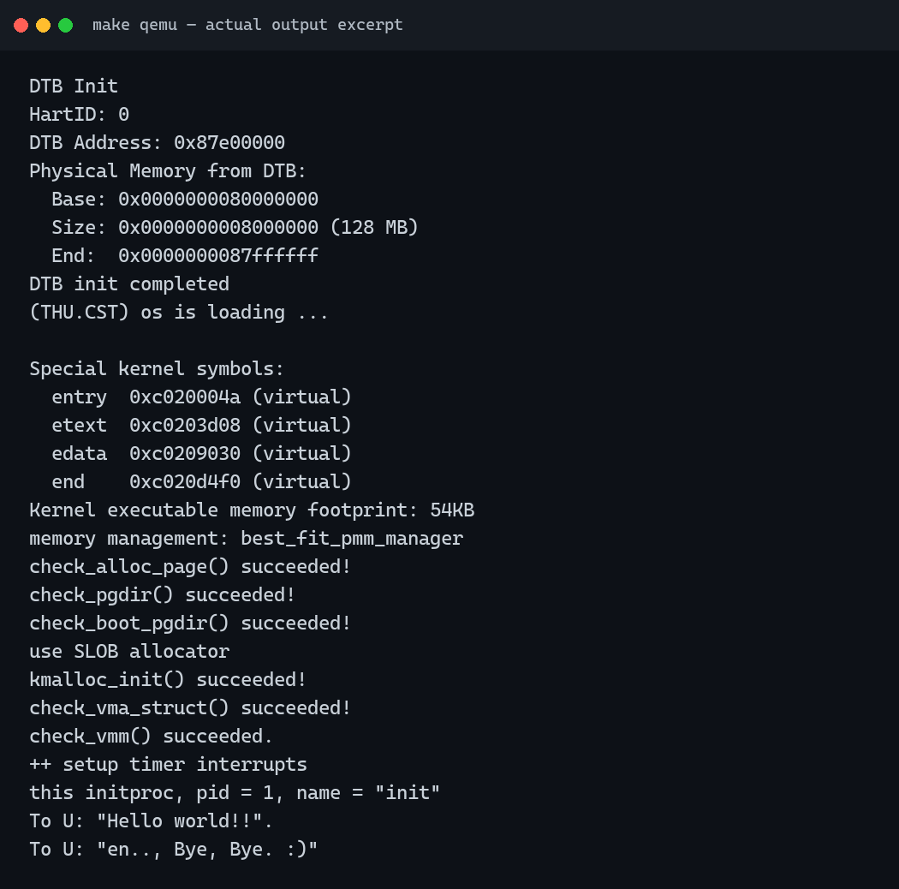

# Lab4：虚拟内存与内核线程实验报告

## 实验信息与小组分工

| 项目 | 内容 |
| --- | --- |
| 课程 | 操作系统 |
| 实验名称 | Lab4：虚拟内存与内核线程 |
| 小组成员 | 2412932 李潇健、2410718 姚钧、2410764 朱彦泽 |
| 初次完成日期 | 2026-11-12 |
| 修订日期 | 2026-11-18 |
| 实验环境 | Windows、WSL2、Ubuntu 24.04，QEMU 8.2.2，OpenSBI v1.3 |
| 编译与构建工具 | `riscv64-unknown-elf-gcc` 13.2.0 / 15.1.0、GNU Make 4.3、Python 3.12.3 |
| AI 辅助工具 | OpenAI Codex |

| 成员 | 负责模块 | 代码与报告分工 |
| --- | --- | --- |
| 2412932 李潇健 | 练习一：虚拟内存操作 | 负责 `get_pte`、`page_insert`、`page_remove` 的规格与提示词设计、页引用计数和 TLB 一致性分析，以及实验整体逻辑、分页问题分析和报告汇总。 |
| 2410718 姚钧 | 练习二：进程创建与初始化 | 负责 `alloc_proc`、`kernel_thread`、`copy_mm`、`copy_thread`、`do_fork`、`proc_init` 的规格与提示词设计，以及 PCB、内核栈、父子关系和创建失败回收路径分析。 |
| 2410764 朱彦泽 | 练习三：调度与上下文切换 | 负责 `cpu_idle`、`schedule`、`proc_run`、`switch_to` 的规格与提示词设计，以及寄存器切换、评分测试、GCC 兼容性问题和运行结果分析。 |

## 一、实验目标与整体逻辑

本实验将页表映射、进程创建和调度连接起来，使内核从单一启动执行流过渡到能够创建并运行内核线程的状态。实现顺序由资源依赖决定：物理页分配和页表访问提供内存基础，PCB 与内核栈保存线程状态，调度器选择执行对象，上下文切换再把处理器交给选中的线程。

### 1.1 从启动到内核线程运行

启动汇编先保存 hart ID 和设备树地址，设置 Sv39 根页表、`satp` 和启动栈，再跳转到高地址的 `kern_init`。初始根页表同时保留低地址恒等映射和内核高地址映射，使写入 `satp` 后、跳转到高地址之前的指令仍可取出执行。

进入 C 代码后，`dtb_init` 读取内存范围；`pmm_init` 建立物理页描述符与空闲块，执行物理页和页表自检，并初始化 SLOB 分配器。随后初始化中断入口、VMA 管理结构和进程管理结构。Lab2 的 best-fit 分配器及 Lab3 的 Trap 保存、恢复和分发代码作为前置实现接入本实验，页表项格式和启动映射按当前 Sv39 环境适配。

`proc_init` 先直接建立 PID 为 0 的 `idleproc`，再通过 `kernel_thread` 和 `do_fork` 建立 PID 为 1 的 `initproc`。初始化时钟和开启中断后，内核进入 `cpu_idle`。由于 `idleproc->need_resched` 已置位，调度器开始选择可运行线程。

新线程尚未在处理器上运行过，必须人为构造第一次恢复所需的状态。`copy_thread` 将 `context.ra` 设为 `forkret`，将 `context.sp` 指向内核栈上的 Trap frame。首次 `switch_to` 的返回路径因此为：

```text
cpu_idle → schedule → proc_run → switch_to
    → forkret → forkrets → __trapret → sret
    → kernel_thread_entry → init_main
```

线程首次运行涉及两次不同层次的恢复：`switch_to` 恢复调度上下文；`__trapret` 恢复 Trap frame 中的寄存器现场，`sret` 再按恢复后的 `sepc` 和 `sstatus` 进入线程入口。

### 1.2 三个模块之间的接口

页表模块提供物理页分配、页表查找和映射维护接口。进程模块使用这些内存资源分配 PCB 与内核栈，并维护 `proc_list`、PID 哈希表和 `struct context`。调度模块只依赖进程状态和上下文选择、切换线程，不承担 PCB 分配和页映射修改。

`PROC_RUNNABLE` 在当前框架中同时覆盖就绪和正在运行的状态，没有单独的 `PROC_RUNNING` 枚举值。因此判断当前执行者要使用 `current`，不能仅根据 PCB 的状态字段区分“正在运行”和“等待运行”。

## 二、练习一：虚拟内存操作

### 2.1 Spec 设计

本练习的规格围绕接口、映射变化和资源计数编写。`page_insert(pgdir, page, la, perm)` 将物理页放到指定虚拟页位置；成功返回 0，无法取得末级页表项时返回 `-E_NO_MEM`。`page_remove(pgdir, la)` 删除已有映射，对不存在的映射不执行释放。

| 输入情形 | 页表操作 | 引用计数与释放要求 |
| --- | --- | --- |
| 目标地址未映射 | 按需建立中间页表，写入目标 PTE | 新物理页引用计数增加一次 |
| 同一物理页覆盖同一地址 | 更新目标 PTE 中的权限 | 引用计数净变化为 0，不释放该页 |
| 另一物理页覆盖旧映射 | 删除旧映射，再写入新 PTE | 新页增加引用，旧页减少引用，旧页归零时释放 |
| 删除已有映射 | 清除目标 PTE | 引用计数减少，归零时释放物理页 |
| 重复删除或删除空地址 | 保持空映射 | 不再减少引用计数，不重复释放 |

此外，修改映射后须使 TLB 中的旧转换失效；中间页表项与最终映射项分别构造，避免把叶子权限写入非叶子项。规格将“同页覆盖”单独列出，是因为它最容易在统一删除旧映射的实现中触发错误释放。

### 2.2 Prompt 设计

提示词同时给出源码范围、行为约束和测试范围，使代码生成以现有结构为边界：

```text
阅读 kern/mm/pmm.c、pmm.h、mmu.h 和 tools/test_lab4.c。
实现 page_insert、page_remove 及所需的内部辅助函数。
插入映射时先获得或创建末级页表项，维护物理页引用计数；
覆盖旧映射时区分同一物理页更新权限和替换为另一物理页。
删除映射后清空 PTE，并使相应虚拟地址的旧 TLB 转换失效。
Sv39 非叶子页表项只设置 Valid，不设置 R/W/X/U。
评分测试调用由注入器添加，不写进正式内核源码。
```

`spec` 说明函数应满足的条件，`prompt` 再指定 AI 要阅读的文件和实现约束。相比只要求“完成页表函数”，这些约束使引用计数、覆盖情形和页表层次成为明确的检查对象。

### 2.3 核心函数与实现分析

`get_pte` 按 `PDX1`、`PDX0`、`PTX` 逐级下降。当中间页表缺失时，只有 `create` 为真才分配页面，设置页引用并将页面清零，然后用 `ptd_create` 写入指向下一级的页表项。页表分配失败或只查找模式下缺少中间页表时返回 `NULL`。

`page_insert` 在取得 PTE 后先增加新页引用。如果旧 PTE 指向同一页，撤销刚增加的一次引用即可；如果指向其他页，则交给 `page_remove_pte` 释放旧映射引用。这个顺序使同页覆盖过程中物理页引用不会先降到 0。最后写入 `pte_create(page2ppn(page), perm)` 并使 TLB 失效。

`page_remove_pte` 统一处理减少引用、归零释放、清空 PTE 和 TLB 失效。`page_remove` 使用 `get_pte(..., 0)`，删除操作不会为了查询一个空地址而新建页表。`pgdir_alloc_page` 将分配物理页和插入映射组合起来，插入失败时归还新分配的物理页。

## 三、练习二：进程创建与初始化

### 3.1 Spec 设计

进程创建不能只以“返回一个 PID”为成功条件，还要保证该 PID 对应的 PCB、内核栈和恢复入口可用。各函数的规格如下。

| 函数 | 规格与关键约束 |
| --- | --- |
| `alloc_proc` | 分配 PCB；初始状态为 `PROC_UNINIT`、PID 为 -1；清零上下文、名称和标志，初始化链表节点，页表地址使用 `boot_pgdir_pa` |
| `kernel_thread` | 以 `int (*fn)(void *)` 和参数构造临时 Trap frame，将函数、参数保存到 `s0`、`s1`，设置 S 态返回状态及 `kernel_thread_entry` |
| `copy_mm` | 当前创建对象是共享内核地址空间的内核线程，检查 `current->mm == NULL` 后返回，不复制用户页表 |
| `copy_thread` | 将 Trap frame 放在子线程内核栈顶，设置子线程返回值 `a0 = 0`，构造 `forkret` 返回地址与上下文栈指针 |
| `do_fork` | 检查进程数，分配 PCB 和内核栈，建立父子关系、地址空间和上下文，分配 PID 并加入管理链表，唤醒子线程；失败时回收已分配资源 |
| `proc_init` | 初始化进程链表和 PID 哈希表；建立 PID 0 的 `idleproc` 与 PID 1 的 `initproc`，设置 `current = idleproc` |

PID 分配与全局链表修改处于保存并关闭本地中断的临界区。`do_fork` 的返回值采用“成功返回子进程 PID、失败返回负错误码”的形式，使调用方能够区分创建失败与合法 PID。

### 3.2 Prompt 设计

```text
根据 proc.h 的 struct proc_struct 和 tools/test_lab4.c，实现
alloc_proc、kernel_thread、copy_mm、copy_thread、do_fork 与 proc_init。
初始化每个 PCB 字段和链表节点；内核线程通过 trapframe 保存入口函数与参数，
经 forkret、forkrets 和 sret 进入 kernel_thread_entry。
do_fork 处理 PCB、内核栈和内存复制失败时的资源回收，
在关中断区间分配 PID，加入哈希表和进程链表。
idleproc 的 PID 为 0，initproc 的 PID 为 1，父进程为 idleproc。
```

提示词从 `proc_struct` 的实际字段出发，明确了首次运行路径和失败处理。尤其是 `context` 与 Trap frame 的关系，不能仅用“复制父进程”概括：新线程需要的是可恢复的初始现场，而不是父线程寄存器内容的简单副本。

### 3.3 核心函数与实现分析

`alloc_proc` 只建立未初始化的进程对象，不立即分配 PID 或将其放入全局链表。这样，在内核栈分配失败时，局部对象可以直接释放，不会留下一个能够被调度器看到但结构尚未完成的进程。

`kernel_thread` 先清零临时 Trap frame，再保存入口函数与参数。状态字设置 `SSTATUS_SPP` 和 `SSTATUS_SPIE`，清除 `SSTATUS_SIE`，使恢复路径在 S 态继续执行，并由 `sret` 按保存的状态恢复中断使能。

`copy_thread` 的两组现场具有不同用途。`context.ra = forkret` 和 `context.sp = proc->tf` 供调度切换使用；Trap frame 中的 `epc`、通用寄存器和状态字供异常返回路径使用。`kernel_thread_entry` 再把 `s1` 放入 `a0`，通过 `jalr s0` 调用线程函数，因此函数参数能够按 RISC-V ABI 传入。

`do_fork` 先完成资源分配和上下文构造，再在临界区分配 PID、加入哈希表和进程链表，最后通过 `wakeup_proc` 设置 `PROC_RUNNABLE`。内核栈分配失败时释放 PCB；`copy_mm` 失败时先释放内核栈，再释放 PCB。当前 `copy_mm` 只处理内核线程并直接返回 0，错误回收分支保留在创建流程中。

`idleproc` 直接使用启动栈，承担没有其他可运行对象时的空闲执行流；`initproc` 经创建接口获得独立内核栈。普通启动输出中 PID 为 1、名称为 `init` 的线程消息，来自 `init_main` 的实际执行。

## 四、练习三：调度与上下文切换

### 4.1 Spec 设计

本练习将“选择谁运行”和“怎样恢复运行”分开约束。

| 函数 | 规格与关键约束 |
| --- | --- |
| `cpu_idle` | 在循环中检查 `current->need_resched`，需要重调度时调用 `schedule` |
| `schedule` | 保存中断状态，清除重调度标志，从当前进程之后循环扫描链表，选择 `PROC_RUNNABLE` 对象；没有可运行候选时使用 `idleproc` |
| `proc_run` | 目标不同于当前进程时，在临界区更新 `current`，按 Sv39 格式写入目标页表对应的 `satp`，刷新 TLB 并切换上下文 |
| `switch_to` | 按 `struct context` 的字段顺序保存旧线程的 `ra`、`sp`、`s0`—`s11`，恢复目标线程的同组寄存器，由 `ret` 进入目标执行位置 |

调度扫描至多绕链表一周，扫描范围可以回到当前进程。若其他线程都不可运行而当前线程仍是 `PROC_RUNNABLE`，调度器可以继续选择当前线程；只有没有可运行候选时才回到空闲线程。

### 4.2 Prompt 设计

```text
实现 cpu_idle、schedule、proc_run 和 switch_to。
schedule 在关中断区间从 current 之后循环扫描 proc_list，
只选择 PROC_RUNNABLE 进程；没有可运行候选时回到 idleproc。
proc_run 更新 current，按 Sv39 格式写 satp、刷新 TLB，再切换上下文。
switch_to 的保存与恢复顺序和 struct context 一致，
保存 ra、sp、s0-s11，不额外保存 caller-saved 寄存器。
用注入测试创建的两个内核线程验证它们都获得运行机会。
```

提示词将结构体布局、汇编寄存器顺序和可观察的测试结果放在同一组约束中，避免仅生成能够返回的汇编函数，却没有保存线程继续执行所需的状态。

### 4.3 核心函数与实现分析

`schedule` 以 `proc_list` 为循环链表。`idleproc` 不作为普通线程加入该链表，因此当前进程为空闲线程时从表头开始扫描；否则从当前进程节点之后开始。调度器跳过链表头与不可运行进程，选中后增加 `runs`，目标不同于当前进程时才执行 `proc_run`。

`proc_run` 写入的 `satp` 由 Sv39 的模式字段和页表物理页号组成，不能直接填入页表虚拟地址或未经移位的物理地址。当前内核线程共享同一内核页表，但切换接口仍执行页表设置与 TLB 刷新。

`switch_to` 位于普通函数调用边界。`s0`—`s11` 属于被调用者保存寄存器；`sp` 确定线程的栈，`ra` 确定本次切换的返回位置。`ra` 虽不属于 ABI 的被调用者保存寄存器，本函数仍须保存它，才能在该线程下一次被选中时回到原调用点。调用者保存寄存器由调用约定和编译器处理，Trap 现场则由 Trap frame 处理，两者不能混为一套寄存器备份。

## 五、代码生成与集成过程中的问题

### 5.1 前置内存管理实现缺失

进程模块补齐后，构建在 `default_pmm.c` 包含 `best_fit_pmm.h` 时失败。检查发现 Lab4 框架中的该文件保留了 Lab2 的 best-fit 测试内容，但缺少相应分配器实现。接入此前 Lab2 的 `best_fit_pmm.c/.h` 与可编译的 `default_pmm.c`，并在 `pmm.c` 中选择 `best_fit_pmm_manager` 后，内核完成链接。

这一问题说明代码生成不能只处理当前练习中的函数签名，还要检查引用的头文件、管理器实例和前置初始化是否存在。后续规格以实际工程依赖为起点，避免将“函数体写出”直接作为模块完成条件。

### 5.2 OpenSBI 没有取得内核入口

最初启动命令使用 `-device loader` 将镜像载入 `0x80200000`。QEMU 8.2.2 的 OpenSBI 输出中，`Domain0 Next Address` 为 0，内核没有进入启动入口。将普通启动和评分启动统一为 `-kernel bin/ucore.img` 后，下一入口变为 `0x80200000`。

定位依据是固件输出中的实际下一跳地址。镜像位于内存中并不等于固件已经得到正确的执行入口，启动参数也属于集成验证的对象。

### 5.3 开启分页后停止取指

指令跟踪显示执行停在写入 `satp` 的位置。初始页表只有内核高地址映射，而此时 PC 仍在 `0x80200000` 附近；分页生效后，下一条指令的低虚拟地址无法按预期转换。增加从 `0x80000000` 开始的 1 GiB 恒等映射，并保留从 `0xffffffffc0000000` 开始的高地址映射后，执行进入 `kern_init`。

修复针对的是分页切换瞬间的执行地址。页表同时覆盖过渡地址与最终地址后，才能完成从低地址执行流到高地址内核的跳转。

### 5.4 非叶子页表项使用了用户权限位

内核运行到低地址映射自检时，异常日志记录了对 `0x100` 的 `store_page_fault`。当时 `get_pte` 将 `PTE_U` 写入中间页表项，非叶子项未满足当前 Sv39 的格式约束。改用 `ptd_create` 生成只含 Valid 的中间页表项，并同步修改旧自检断言后，`check_boot_pgdir()` 通过。

该问题促使页表模块的规格和提示词明确区分中间项与叶子项。用户访问权限属于最终映射的约束，不能不加区分地附加到每一级页表项。

### 5.5 测试线程类型与接口不一致

评分器中的线程函数最初声明为 `void test_lab4_thread(void *)`，而 `kernel_thread` 接收 `int (*)(void *)`。GCC 13.2.0 给出警告，交互终端使用的 GCC 15.1.0 则将其判为错误。失败发生在评分内核编译阶段，此时显示的 `0/30` 不代表三项运行测试已经执行并失败。

将测试线程的返回类型改为 `int` 并补上返回语句后，两套编译环境均得到 `30/30`。修改保持了原测试断言和线程调度循环，没有通过函数指针强制转换绕过接口检查。该过程也说明复现环境需要检查实际使用的编译器路径，不能只根据 Ubuntu 发行版判断工具链版本。

## 六、测试方法与运行结果

### 6.1 页表与进程测试

构建和运行命令为：

```sh
make clean
make -j2
make grade
make qemu
```

`make grade` 在临时副本中注入测试。页表测试分配三个物理页，依次检查首次映射、不同页覆盖、同页权限更新和重复删除，断言映射目标、引用计数及空闲页数量符合预期。进程测试检查 `idleproc` 与 `initproc` 的 PID、状态、父子关系、内核栈和上下文字段。调度测试创建两个线程，在线程循环与主测试流程中主动调用 `schedule`，最后检查两个线程都曾运行。

| 测试项 | 观察结果 | 结果含义 |
| --- | --- | --- |
| PMM | `OK` | 给定映射替换与删除操作后的 PTE、页引用计数和空闲页变化符合断言 |
| Process Create | `OK` | 初始进程对象及首次恢复所需的关键字段符合断言 |
| Schedule | `OK` | 两个测试线程均获得运行机会，`init` 线程也执行了预设输出 |

三项测试各 10 分，总分为 `30/30`。GCC 13.2.0 与 GCC 15.1.0 环境均得到该结果。图 1 展示评分输出。


### 6.2 普通启动结果

QEMU 的设备树给出 128 MiB 物理内存。启动时依次输出 `check_alloc_page()`、`check_pgdir()`、`check_boot_pgdir()`、SLOB 和 VMA 自检通过信息，随后出现：

```text
this initproc, pid = 1, name = "init"
To U: "Hello world!!".
To U: "en.., Bye, Bye. :)"
```

这些消息来自 `init_main`，说明新线程经内核栈和两层现场恢复路径进入了入口函数。图 2 展示内存初始化与线程运行输出。



`init_main` 返回后，`kernel_thread_entry` 调用 `do_exit`；当前框架在该函数中执行 `panic("process exit!!.")`，随后进入调用关机接口的监视器路径。该输出对应线程函数结束后的框架行为。评分器对调度的验证来自主动切换线程的测试，没有测量调度延迟、公平性或时间片抢占效果。

## 七、Challenge 分析

### 7.1 `local_intr_save` 与 `local_intr_restore`

该问题的规格是解释进入、退出临界区时应保留怎样的中断状态，以及嵌套调用是否会提前开启中断。提示词以 `kern/sync/sync.h` 为依据，要求分析 `sstatus.SIE`、布尔标志和两层嵌套调用，而不只说明“关中断、开中断”。

`local_intr_save(intr_flag)` 检查 `sstatus.SIE`。原来开启时关闭中断并记录 1；原来关闭时记录 0。恢复操作只在标志为 1 时开启中断。若外层保存时关闭了中断，内层保存得到 0，内层退出就不会提前开启中断；外层退出时再恢复原状态。

该机制防止本 CPU 的可屏蔽中断打断临界区。实验为单 hart 环境；在多核系统中，关闭本地中断不能阻止另一个 CPU 访问同一数据，仍需结合锁和内存同步机制。

### 7.2 Sv32、Sv39、Sv48 与 `get_pte` 的重复逻辑

该问题的规格包括比较分页层数、说明两段代码各处理哪一级，以及讨论查找和分配接口是否应拆分。提示词要求结合 `PDX1`、`PDX0`、`PTX`、`create` 和分配失败路径分析。

| 分页模式 | 页表层数 | 各级索引位数 | 基本页内偏移 |
| --- | --- | --- | --- |
| Sv32 | 2 | 每级 10 位 | 12 位 |
| Sv39 | 3 | 每级 9 位 | 12 位 |
| Sv48 | 4 | 每级 9 位 | 12 位 |

三者都按虚拟页号逐级查表，最终将物理页号与页内偏移组合。当前 `get_pte` 的第一段处理根页表到下一层，第二段处理下一层到末级页表；每一层都执行“索引、检查有效位、必要时分配并清零、继续下降”，因此结构相似。

`get_pte(pgdir, la, create)` 用一个参数区分纯查找与查找并创建，调用关系较直接。若扩展到不同层数，可抽出下降一级的操作，再按分页层数循环；如果要细分分配失败后的回收，也可把只读查找与创建接口分离。拆分减少重复代码，但需要明确中间页表的所有权和失败处理，不能只把现有两个代码块合成一个循环而忽略这些约束。

## 八、实验知识点与 OS 原理的对应

| 实验知识点 | OS 原理中的含义 | 联系与区别 |
| --- | --- | --- |
| 页表映射与页引用计数 | 虚拟地址转换、内存共享和资源生命周期 | PTE 决定地址转换，引用计数决定物理页能否释放；删除一个虚拟映射不必然立即释放物理页 |
| 多级页表与 TLB | 页表分层节省空间，TLB 缓存地址转换 | 修改页表属于软件数据结构操作，刷新 TLB 用于更新处理器缓存；二者都正确才能避免继续使用旧转换 |
| PCB 与进程状态 | 内核用管理结构描述执行对象及其资源 | `proc_struct` 是具体实现；抽象的就绪、运行状态在本框架中由 `PROC_RUNNABLE` 和 `current` 共同表达 |
| 内核栈、Trap frame 与 context | 运行现场保存和执行流恢复 | Trap frame 保存陷入或返回需要的现场，context 保存调用边界上的调度现场；新线程使用人为构造的初始现场启动 |
| 循环扫描可运行线程 | 调度策略与调度机制 | `schedule` 选择对象，`switch_to` 实现切换；本实验验证多个线程获得执行机会，不等于验证时间片轮转的全部性质 |
| 内核线程共享页表 | 线程共享地址空间、保留独立执行状态 | 各线程共享内核地址空间，但 PCB、内核栈和 context 独立；与具有独立用户地址空间的进程存在区别 |
| 保存并关闭本地中断 | 临界区保护与并发控制 | 单核中可防止中断引发的交错访问，多核互斥还需要锁；保存原状态比无条件开关中断更适合嵌套临界区 |
| 创建失败时逐层回收资源 | 内核资源管理与失败原子性 | `do_fork` 按已取得资源逆序清理；它与线程正常退出后的资源回收属于不同路径 |

## 九、OS 原理中重要但本实验未对应的内容

| 知识点 | 原理中的作用 | 与本实验范围的区别 |
| --- | --- | --- |
| 用户态隔离、系统调用与程序装载 | 限制应用权限，使应用通过受控入口请求内核服务 | 本实验线程在 S 态执行，没有运行独立用户程序，也没有验证用户态系统调用路径 |
| 按需分页、页面置换和交换 | 在物理内存有限时管理进程工作集，以缺页处理和置换扩展可用空间 | 本实验验证映射插入、替换和删除，没有运行换入换出或置换算法 |
| 写时复制与独立用户地址空间 | 降低进程复制成本，并在写入时保持进程间隔离 | 当前 `copy_mm` 面向共享内核地址空间的线程，没有执行用户地址空间复制 |
| 抢占式调度、优先级与实时调度 | 通过时钟、优先级和期限控制 CPU 分配与响应 | 当前调度测试主动调用 `schedule`，没有验证时间片到期强制切换、优先级竞争或期限保证 |
| 阻塞、等待、僵尸进程和正常退出 | 管理线程等待事件、终止以及父进程回收资源的完整生命周期 | 本实验使用创建和可运行状态，`do_exit` 为框架的 panic 路径，没有完成等待与正常退出回收 |
| 多核同步与内存一致性 | 协调多个 CPU 对共享对象的访问和可见性 | 实验运行于单 hart，本地关中断的结果不能直接推广为多核互斥 |
| 文件系统、持久化与设备 I/O | 管理持久数据、设备访问和 I/O 完成事件 | 本实验主要使用终端输出与定时器，没有实现文件系统或块设备请求管理 |

## 十、实验总结

本实验的实现依赖于两种一致性：页表项、物理页引用计数和 TLB 必须对同一映射变化保持一致；PCB、内核栈、context 和 Trap frame 必须对同一执行流保持一致。同页覆盖时保留物理页、首次运行时构造 `forkret` 返回路径，分别体现了这两组约束。

在给定评分场景中，映射维护、初始进程创建和多个内核线程运行均通过测试。启动映射、非叶子页表项和测试回调类型的修复表明，接口规格需要同时覆盖硬件格式、C 函数类型与工具链条件，模块代码才能在实际启动和调度路径中工作。
